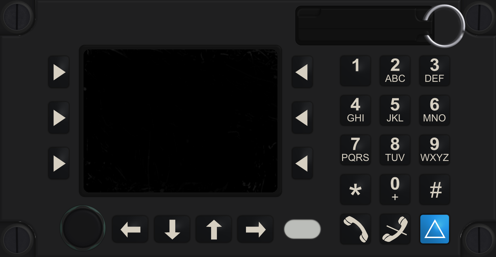
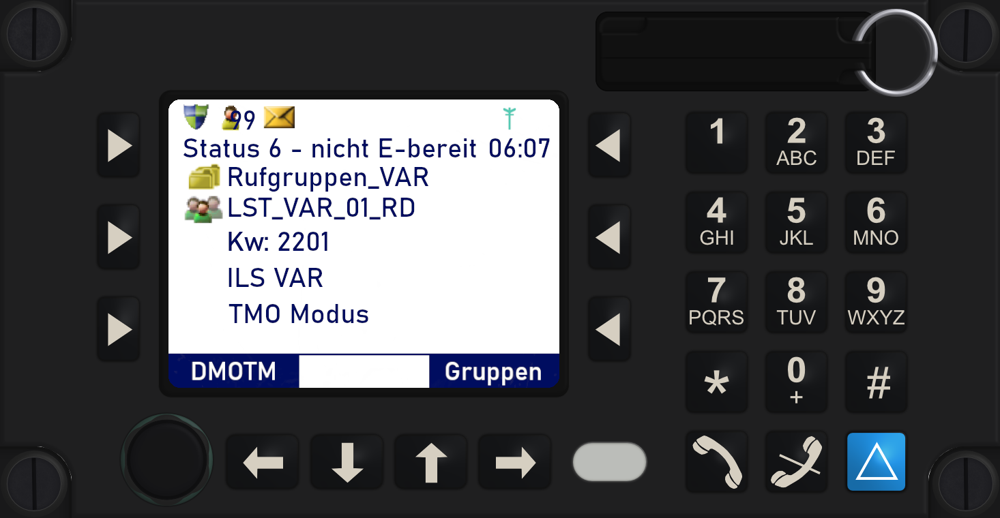
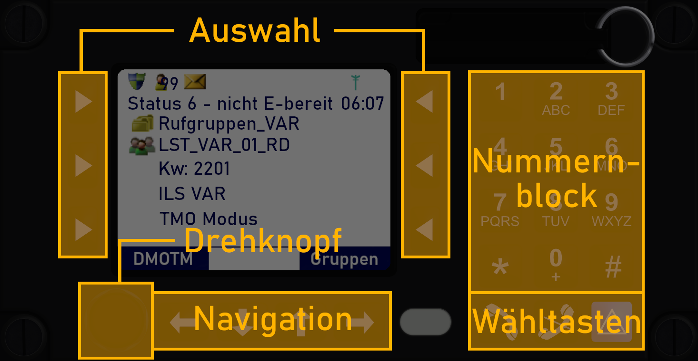
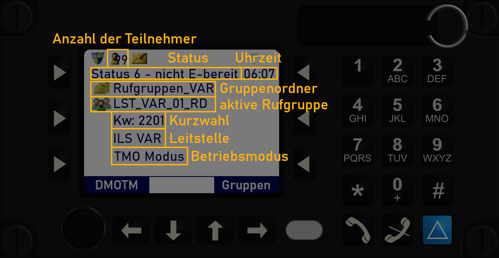
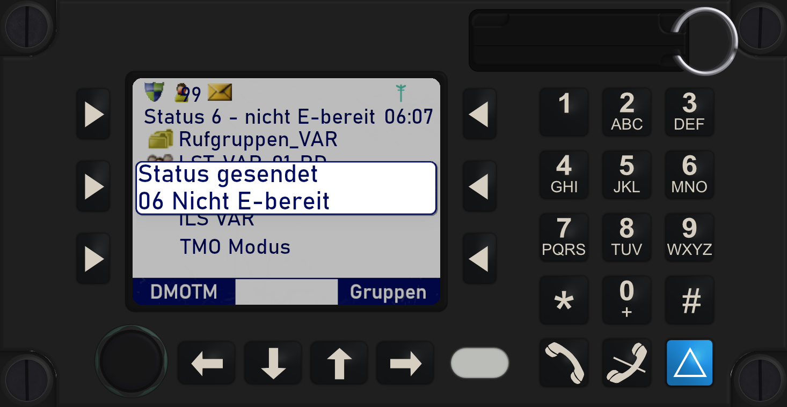
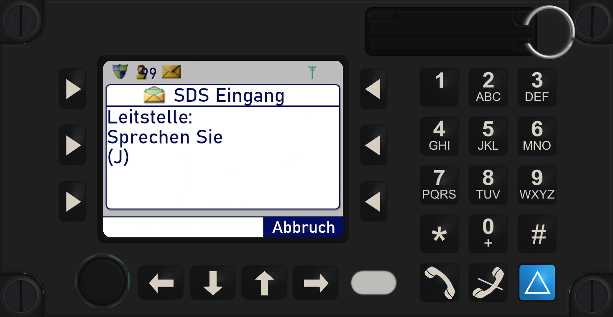
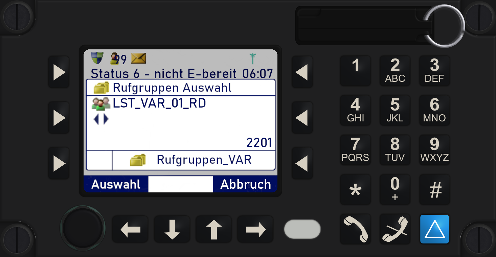
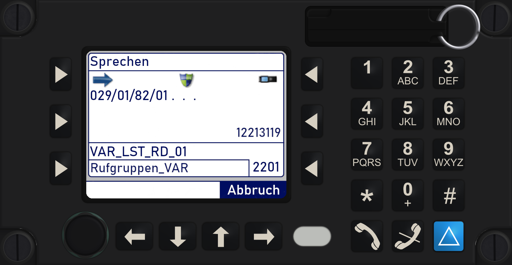
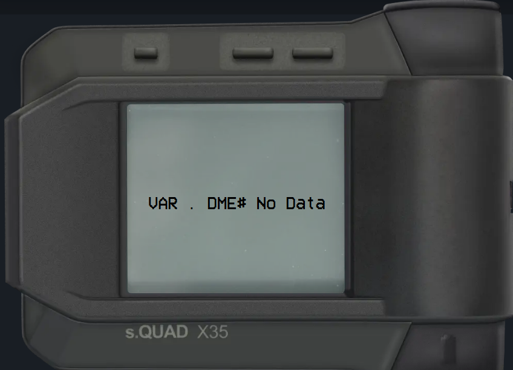

# Pilotenansicht

Auf dieser Seite geht es um die [Pilotenansicht](https://ops.virtualairrescue.com/pilot)
unseres Leitstellensystems. Dort meldest du dich an, funkst mit der Leitstelle,
empfängst Alarmierungen und telefonierst.

## Verbinden

Über **Verbinden** in der Navigationsleiste wählst du deine Station und meldest
dich an. Voraussetzung ist, dass dein VAR-Account mit Discord verknüpft ist und
du alle offenen Pflicht-NOTAMs bestätigt hast. Das kannst du direkt in der
Pilotenansicht erledigen.

### Auto-Dispatch

Im Verbinden-Dialog kannst du **Automatische Einsätze erhalten** anhaken. Dann
bekommst du Einsätze vom System, solange **kein Disponent online** ist. Die
Option gilt nur für die aktuelle Sitzung. Die Einsätze passen zu deiner Station:
Je nach Station sind es Primäreinsätze, Verlegungen oder eine Mischung aus
beidem.

Einen automatischen Einsatz deiner eigenen Station darfst du selbst
abschließen, über den Knopf **Einsatz abschließen** im Einsatzpopup. Alle
anderen Einsätze schließt die Leitstelle.

::: info Open Beta
Der Auto-Dispatch ist noch in der Open Beta. Weitere Einstellungen dazu findest
du im HUB.
:::

## MRT

Das Mobile Radio Terminal, kurz MRT, ist die Schnittstelle zwischen Hubschrauber
und Leitstelle. Darüber funkst du, sendest Status und empfängst SDS-Nachrichten.

Wir bilden die Hubschrauberbedieneinheit **HBE767** der elektronik-labor CARLS
GmbH & Co. KG nach, die in Deutschland in den meisten Rettungshubschraubern
verbaut ist. Zusammen mit dem TETRA-Funkgerät **Sepura SCG22** bindet sie
Luftrettungsmittel an den Digitalfunk an. Das Aussehen der HBE ist nahezu
originalgetreu, die Sepura-Oberfläche bilden wir nur in den Grundfunktionen
nach.

### Einschalten

Das Gerät startet, sobald du dich verbindest oder die Taste **1** gedrückt
hältst. Es bucht sich automatisch in die Rufgruppe `LST_VAR_01_RD` ein.

### Bedienung

Über den Nummernblock sendest du Status oder gibst Kurzwahlnummern ein. Die
Auswahlknöpfe links und rechts vom Bildschirm wählen vor allem die beiden
unteren Optionen. Im Beispiel unten wählt der linke untere Knopf „DMOTM(O)“, der
rechte untere öffnet die Gruppenauswahl. Dort wechseln die Navigationsknöpfe
zwischen Gruppen und Ordnern. Ein Druck auf den Drehknopf öffnet ebenfalls die
Gruppenauswahl.

Was die einzelnen Anzeigen auf dem Bildschirm bedeuten:

### Status und SDS-Text senden

Halte die entsprechende Taste im Nummernblock **länger als 0,6 Sekunden**
gedrückt. Ein Popup bestätigt das Senden.

::: info Status oder SDS-Text
Die HBE unterscheidet zwischen Status und SDS-Text. SDS-Texte sind
(priorisierte) Sprechwünsche, Fahrzeuganmeldungen und Texte von der Leitstelle
an dich. Ein SDS-Text ändert deinen Status **nicht**. Drückst du die 5, erfährt
die Leitstelle per SDS von deinem Sprechwunsch, dein Status bleibt aber gleich.
:::

Welche Ziffer was bedeutet, steht unter [Status](/luftrettung/bos-funk/Status).

### SDS-Text empfangen

Schickt dir die Leitstelle einen SDS-Text, schließt du das Popup mit dem rechten
unteren Auswahlknopf („Abbrechen“).

### Rufgruppe wechseln

Die Rufgruppe wechselst du im Gerät selbst:

1. Gruppenauswahl über „Gruppen“ oder einen Druck auf den Drehknopf öffnen.
2. Rufgruppe mit den Pfeiltasten wählen **oder** die Kurzwahl eintippen
   (22 + Nummer der Rufgruppe). Danach erscheint der passende Name.
3. Fünf Sekunden warten oder „Auswahl“ drücken.

### Gruppenruf

Halte die Sprechtaste gedrückt, bis der Ruf aufgebaut ist. In der Kopfzeile des
Gruppenruf-Fensters steht dann **„Sprechen“**.

## Melder

Der Digitalfunkmeldeempfänger (DME) bleibt immer beim Crewmitglied. Darüber
kommt die Alarmierung mit Ton und Text: eine kurze Einsatzbeschreibung und der
Einsatzort. Im Ruhezustand stehen dein Rufname und dein Name auf dem Display.

- Die **obere linke Taste** bringt dich nach einer Alarmierung zurück zum
  Hauptbildschirm.
- Der **runde Knopf oben rechts** (hier nur von der Seite zu sehen) quittiert den
  Einsatz und stoppt den Piepton.
- Die **beiden rechten Tasten oben** blättern seitenweise durch längere Texte,
  das Mausrad zeilenweise. Ein Symbol unten rechts zeigt, dass noch Text folgt.
- **Erneut senden** lässt dir den letzten Einsatz noch einmal zustellen.
- **Einsatz kopieren** kopiert den letzten Einsatz als Klartext, zum Beispiel
  für den Chat.

Die **Schriftgröße** des Melders stellst du in den Einstellungen unter „Melder“
zwischen 60 und 130 % ein. Kleinere Schrift zeigt mehr Text auf einer Seite.

## Diensthandy

Das Diensthandy blendest du über den Knopf **Diensthandy** links auf der Karte
ein und aus. Es schaut unten am Bildschirmrand heraus und fährt hoch, sobald du
mit der Maus darüber fährst oder ein Anruf eingeht. Mit dem Pin am Gehäuse
bleibt es oben.

Darauf findest du diese Apps:

- **Telefon:** Tastatur, Anrufliste mit verpassten Anrufen und Kontakte. In den
  Kontakten stehen die Leitstellen und alle Luftfahrzeuge, die gerade online
  sind. Die **112** verbindet dich immer mit der Leitstelle. Die Nummer deiner
  Station steht im Stations-Reiter des Hubschrauber-Popups.
- **Nachrichten:** Kurznachrichten an andere Piloten und Disponenten.
- **Einstellungen:**
  - **Töne:** Lautstärke, Klingelton, Benachrichtigungston, auch mit eigener
    Datei
  - **Anrufe:** Anrufe von Piloten erlauben, Push bei Anrufen, eigene Nummer
  - **Anzeige:** eigenes Hintergrundbild

Während eines Telefonats ist der Funk leiser und du sendest nicht. Schaltest du
dein Mikrofon im Telefonat **stumm**, kannst du nebenbei funken.

::: tip Push bei Anrufen
Wenn du es in den Einstellungen einschaltest, bekommst du bei eingehenden
Anrufen eine Push-Benachrichtigung über NTFY oder Pushover. Die Zugangsdaten
für Pushover trägst du in den Einstellungen der Pilotenansicht oder im HUB ein.
:::

## Zielklinik von der Leitstelle

Die Leitstelle kann dir für einen laufenden Einsatz eine **Zielklinik** zuweisen.
Du bekommst dann eine Benachrichtigung mit Ton, und auf der Karte erscheint eine
Linie von deinem Hubschrauber zur Klinik mit Kurs, Entfernung und Flugzeit.

Bei Verlegungen zeigt die Karte die Route von der Start- zur Zielklinik. Sobald
du Status 7 meldest, wandert das Einsatzlabel zur Zielklinik.

## AFK

Musst du kurz weg, ohne deine Station freizugeben, meldest du dich **AFK**. Du
wählst 5, 10, 15 oder 30 Minuten. Deine Station bleibt besetzt, und die
Leitstelle sieht, dass du gerade nicht am Platz bist.

AFK endet automatisch, wenn:

- du dich im Simulator bewegst (mehr als 100 m, schneller als 5 kt oder eine
  neue Flugphase),
- du selbst einen Status setzt,
- du alarmiert wirst (ein Alarm erreicht dich immer),
- du dich neu verbindest.

Während du AFK bist, bekommst du **keine automatischen Einsätze**. Läuft die
Zeit ab, fragt die Pilotenansicht **„Noch da?“**, auch per Push. Antwortest du
nicht, endet nur das AFK, deine Sitzung bleibt bestehen.

## Flugbuch

Jeder Flug wird automatisch im Flugbuch erfasst: Off-Block, Start, Landung und
On-Block. Start- und Zielort ermittelt das System aus Kliniken, Landeplätzen,
Flughäfen und Stationen.

Nach der Landung erscheint der Hinweis **Flug abgeschlossen** mit den erfassten
Zeiten und Orten. Stimmt alles, bestätigst du ihn. Sonst korrigierst du Zeiten
und Orte direkt. Das geht **24 Stunden** lang, auch später im HUB unter
Logbuch > Flüge. Geschätzte Orte sind markiert, bis du sie bestätigst.

## Zweiter Bildschirm

MRT, Melder und Diensthandy kannst du in ein eigenes Fenster auslagern, zum
Beispiel auf einen zweiten Monitor:

- **Auslagern** an MRT und Melder bzw. der Pfeil-Knopf am Diensthandy lagert ein
  einzelnes Gerät aus.
- Der Knopf links auf der Karte lagert **alle Geräte** auf einmal aus oder holt
  sie zurück.
- Im zweiten Fenster holt **Zurückholen** ein Gerät zurück, **+ Gerät** holt
  fehlende dazu.

Sind MRT und Melder beide ausgelagert, wird die Karte im Hauptfenster breiter.
Die Schrift der Geräte wächst mit der Fenstergröße. Das Hauptfenster muss offen
bleiben. Ist es geschlossen oder bist du nicht verbunden, zeigt das zweite
Fenster **„Kein Signal“**. Der Knopf auf der Karte leuchtet dann gelb.

::: info Für Streamer
Mitglieder mit der Streamer-Rolle haben im zweiten Fenster eine
**Stream-Ansicht**: Die Geräte stehen auf einer einfarbigen Fläche (Magenta,
Grün oder Blau), die sich in OBS per Chroma Key ausblenden lässt. Nimm dafür das
Fenster als Fensteraufnahme auf, nicht als Browserquelle. Mit dem Haken **Ich
bin live auf Twitch** zeigt der Melder deinen Twitch-Namen statt deines echten
Namens.
:::

## Karte

- **Stationen:** Ein Klick auf eine Station öffnet das Stations-Popup, auf der
  Ebene „LRZs“ auch für Stationen ohne Hubschrauber online. Mit
  **Shift-Klick** blendest du stattdessen die Reichweitenringe ein.
- **Kliniken:** Ab Zoomstufe 9 erscheinen die Kliniken. Ein Klick öffnet das
  Klinik-Popup mit Details. Über den Reiter **Klinikdaten melden** meldest du
  falsche Angaben wie Name, Lage, Landeplatz oder Fachabteilungen.
- **Popups automatisch schließen:** In den Einstellungen legst du fest, ob sich
  Popups beim Klick auf die Karte schließen.

Die Kartenebenen sind dieselben wie in der Leitstelle, siehe
[Webleitstelle](/var-systeme/webleitstelle#kartenebenen).

## Benachrichtigungen und Einstellungen

Zuweisungen, AFK-Meldungen der Leitstelle und ähnliche Hinweise landen im
**Benachrichtigungs-Center** und werden mit einem Ton angekündigt.

Das Zahnrad in der Navigationsleiste öffnet die Einstellungen mit Kategorien,
etwa „Audio“ mit allen Lautstärken, „Melder“ mit der Schriftgröße und
„Benachrichtigungen“ mit NTFY und Pushover.

## Ambulanz-Jets

Ambulanz-Jets fliegen nicht über die Pilotenansicht, sondern über eine eigene
Ansicht ohne Funk, mit Aufträgen aus mehreren Abschnitten. Alles dazu steht unter
[Jet-Ansicht](/var-systeme/jet).
