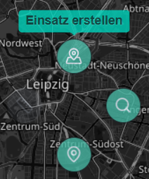
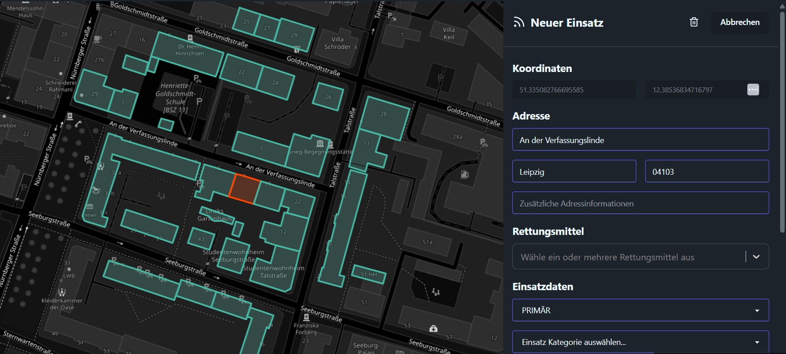
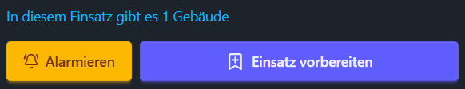
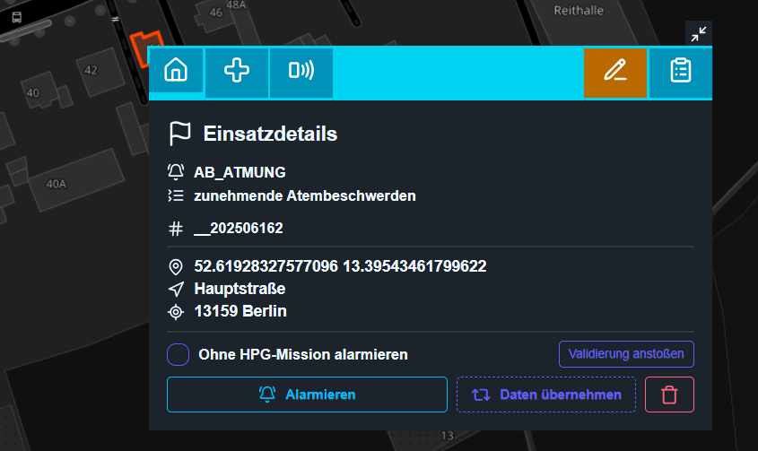
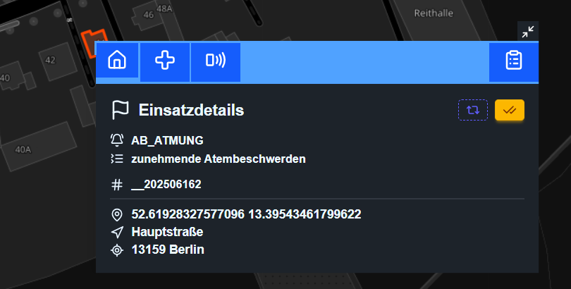
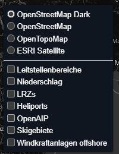
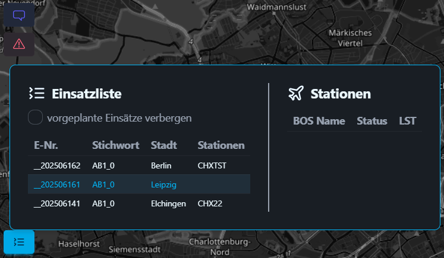

# Webleitstelle

Auf dieser Seite geht es um die [Webleitstelle](https://ops.virtualairrescue.com/dispatch)
unseres Leitstellensystems.

Solange du als Disponent aktiv bist, muss die Webleitstelle geöffnet bleiben.
Über sie läuft die gesamte Kommunikation und Koordination.

## Verbinden und Zuständigkeit

### Freigabe durch einen aktiven Disponenten

Bist du der erste Disponent online, bist du nach dem Verbinden sofort **aktiv**.
Sind bereits Disponenten aktiv, **wartest** du nach dem Verbinden, bis dich einer
von ihnen freigibt. Sprecht euch dafür im Discord ab.

Solange du wartest, kannst du nur zusehen: Du hörst den Funk, kannst aber nicht
senden, keine Einsätze anlegen oder ändern, keine Status setzen und nicht
telefonieren. Ein Hinweis oben auf der Karte zeigt dir, dass du noch wartest.

Bei der Freigabe wählt der aktive Disponent eine von zwei Arten:

- **Übergabe:** Du übernimmst komplett. Bisherige Aufteilungen fallen weg.
- **Absprache:** Ihr arbeitet gemeinsam. Die bestehende Aufteilung bleibt.

Die aktiven Disponenten bekommen einen Hinweiston, sobald sich ein weiterer
Disponent verbindet. Lädst du die Seite neu und bist innerhalb von zwei Minuten
zurück, bleibst du aktiv.

### Zuständigkeit aufteilen

Über den Knopf **Zuständigkeit** links auf der Karte öffnest du das Panel zur
Aufteilung. Dort siehst du alle Disponenten, offene Übergaben, Rufgruppen und
Stationen.

- **Rufgruppen** teilst du je Disponent über die Knöpfe „RG 01“, „RG 02“ usw.
  zu. Eine Rufgruppe gehört immer genau einem Disponenten.
- **Stationen** lassen sich auch einzeln zuteilen.
- Möchtest du einem anderen aktiven Disponenten etwas geben, ist das eine
  **Übergabe-Anfrage**. Er muss sie annehmen oder ablehnen.

Ist eine Station niemandem ausdrücklich zugeteilt, ist zuständig, wer auf
derselben Rufgruppe funkt wie der Pilot. Gibt es auch dort niemanden, sind alle
aktiven Disponenten zuständig.

Sprechwünsche, Notrufe, Statuswechsel und Anrufe eines Piloten gehen **nur an
die zuständigen Disponenten**. Mit dem Schalter **Nur meine Zuständigkeit**
blendest du fremde Stationen und Einsätze auf der Karte und in den Listen aus.
Einsätze, die noch keiner Station zugeordnet sind, bleiben sichtbar.

### AFK

Musst du kurz weg, meldest du dich **AFK** (neben „Verbunden“ oder im Panel
„Zuständigkeit“). Du wählst 5, 10, 15 oder 30 Minuten. Freigabe und
Zuständigkeiten behältst du, Meldungen gehen aber zuerst an die anwesenden
Kollegen. Sind alle AFK, erreichen sie trotzdem dich.

- Die anderen Disponenten bekommen sofort einen Hinweis, betroffene Piloten nach
  einer Minute.
- Im AFK-Dialog kannst du festlegen, dass in dieser Zeit der **Auto-Dispatch**
  Einsätze vergibt.
- Läuft die Zeit ab, fragt die Webleitstelle **„Noch da?“**. Reagierst du nicht
  innerhalb von fünf Minuten, wirst du abgemeldet.
- Warten Disponenten auf eine Freigabe, können sie drei Minuten nach deiner
  angekündigten Rückkehr übernehmen.

## Einsatzalarmierung

Mit einem Rechtsklick auf die Karte kannst du an dieser Position einen neuen
Einsatz anlegen.

Die anderen Knöpfe im Kontextmenü suchen nach Gebäuden an dieser Position,
kopieren die Koordinaten in die Zwischenablage oder öffnen die
[Messwerkzeuge](#messwerkzeuge).

Die Karte zentriert sich auf den Ort, Gebäude im näheren Umkreis werden markiert
und rechts öffnet sich die Einsatzmaske.

Die markierten Gebäude sind blau oder orange. Orange Gebäude gehören zum
Einsatz. Ein Klick auf ein blaues Gebäude fügt es hinzu, ein Klick auf ein
oranges entfernt es wieder. Über Rechtsklick → Lupe wird die Markierung
zurückgesetzt und an der neuen Position neu gestartet.

### Rettungsmittel wählen

Die Stationsauswahl in der Maske ist in Gruppen sortiert:

- **Fahrzeuge**
- **Verbundene Stationen** (grünes Funk-Symbol), sortiert nach Entfernung zur
  Kartenmitte mit Angabe in Kilometern
- **Alle Stationen**, alphabetisch

Ist ein Pilot gerade AFK, steht das an der Station, und die Maske zeigt eine
Warnung. Ein Alarm erreicht ihn trotzdem und beendet sein AFK.

Auf dem [zweiten Bildschirm](#zweiter-bildschirm) kannst du Stationen auch
direkt aus dem Ressourcen-Tableau in die Maske ziehen.

### Einsatzvorschlag

Fällt dir gerade kein Einsatz ein, erzeugt der Knopf **Einsatzvorschlag für den
ersten Hubschrauber** ein passendes Szenario für die erste gewählte Station. Bei
Verlegungen heißt der Knopf „Verlegungsvorschlag“.

### Verlegungen und Organtransporte

Bei einer **Verlegung** ersetzt der Block „Verlegung“ die Adresse: Du wählst
**Start- und Zielklinik**. Die Klinikauswahl sucht nach Namen und sortiert nach
Entfernung zur Kartenmitte. Alternativ klickst du eine Klinik auf der Karte an
und übernimmst sie mit **Als Startklinik** bzw. **Als Zielklinik**. Die Karte
zeigt die Flugroute mit Kurs, Entfernung und Flugzeit.

Ein **Organtransport mit Hubschrauber** ist eine Verlegung mit ausgefülltem Feld
„Organ“. Stichwort und Frist ergeben sich daraus.

### Aufträge für Ambulanz-Jets

Mit den Einsatzarten **Organtransport (Jet)** und **Ambulanzflug (Jet)** legst
du Aufträge für Jet-Piloten an: Kliniken, Organ, Jet-Pilot und Flughäfen. Die
Webleitstelle rechnet die ganze Kette mit Bodentransporten und Flügen und zeigt
Warnungen, wenn etwas nicht passt. Der Pilot bekommt den Auftrag mit Hinweiston
zugewiesen.

Die Bodentransporte zwischen Klinik und Flughafen übernimmt standardmäßig ein
simulierter RTW. Je Abschnitt kannst du stattdessen einen **Hubschrauber** als
Zubringer einsetzen: eine bestimmte Station, „automatisch wählen“ oder sofort
alarmieren. Im Einsatzpopup siehst du den Ablauf, kannst zwischen RTW und
Hubschrauber umschalten, **Hubschrauber jetzt alarmieren** oder den **Auftrag
abbrechen**.

### Speichern und alarmieren

Den Einsatz kannst du sofort alarmieren oder nur vorbereitet speichern.

Vorbereitete Einsätze erscheinen hellblau und sind nur für angemeldete
Disponenten sichtbar. Aktive Einsätze erscheinen dunkelblau und sind für alle
sichtbar.

Im Einsatzpopup siehst du auf der Startseite Adresse und Stichwort und kannst
den Einsatz alarmieren oder löschen. Der zweite Reiter zeigt Patienten- und
Einsatzinformationen, der dritte dient zum Nachalarmieren. Mit dem orangen
Stift bearbeitest du einen vorbereiteten Einsatz. Im letzten Reiter steht das
Einsatzlog mit Zeitstempeln der Statusmeldungen und den Notizen der
Disponenten.

## Nach der Alarmierung

Die Alarmierungsoptionen sind jetzt verschwunden. Mit den zwei Knöpfen oben
rechts kannst du den Einsatz **kopieren** und daraus einen neuen erstellen oder
ihn **abschließen**. Im Reiter Nachalarmierung sendest du die Alarmierung an
derselben Stelle erneut.

### Zielklinik je Hubschrauber

Für jeden alarmierten Hubschrauber kannst du eine eigene **Zielklinik** setzen,
am einfachsten über die [Klinikanmeldung](#klinikanmeldung). Die Piloten der
Station bekommen eine Benachrichtigung mit Ton, und auf der Karte erscheint eine
Linie vom Hubschrauber zur Klinik. Entfernen kannst du die Zielklinik im Reiter
Rettungsmittel des Einsatzpopups oder im Hubschrauber-Popup.

Sobald ein Hubschrauber Status 7 oder 8 meldet, wandert das Einsatzlabel von der
Startklinik zur Zielklinik.

### Statusverlauf

Jeder Statuswechsel einer Station wird gespeichert. Du siehst den Verlauf im
Stations-Reiter des Hubschrauber-Popups, im Einsatzlog und im Statusmenü des
Ressourcen-Tableaus („Seit 14:32 (vor 12 Min.)“). Der Reiter **Zeiten** im
Einsatzpopup rechnet daraus die Einsatzzeiten.

## Klinikanmeldung

Mit der Klinikanmeldung findest du eine aufnahmebereite Klinik für deinen
Patienten, ähnlich wie bei einem echten Anruf in der Notaufnahme.

1. **Station wählen.** Vorgeschlagen werden die Stationen aus der offenen Maske
   und aus deinem letzten Telefonat. Der Ort des Patienten richtet sich nach dem
   laufenden Einsatz oder der Position des Hubschraubers. Mit „Kartenmitte“ oder
   einem Rechtsklick auf die Karte setzt du ihn von Hand.
2. **Patient beschreiben:** Alter, Verdachtsdiagnose, intubiert, Schockraum,
   benötigte Fachabteilungen und Besonderes. Die Verdachtsdiagnose kannst du aus
   Vorlagen wählen oder frei eingeben. Eine Vorlage füllt die Anforderungen vor.
3. **Suchen.** Standardmäßig wird im Umkreis von 30 Flugminuten gesucht. Über
   das Feld „Umkreis“ stellst du 30, 60, 90 oder 120 Minuten oder „Auto“ ein.

Jede Klinik in der Liste antwortet sofort: **aufnahmebereit**, **belegt** oder
**kann nicht versorgen**. Die Liste ist nach Entfernung sortiert. Belegte
Kliniken bleiben ausgegraut an ihrer Stelle, damit du siehst, dass ein näheres
Haus gerade nicht aufnimmt. Fährst du mit der Maus über eine Klinik, pulsiert
sie auf der Karte.

Fragst du dieselbe Klinik innerhalb von 30 Minuten erneut mit gleichen oder
geringeren Anforderungen an, gibt sie dieselbe Antwort, auch anderen
Disponenten.

Bei einer aufnahmebereiten Klinik kannst du:

- sie **auf der Karte zeigen**,
- sie bei Verlegungen und Organtransporten **als Zielklinik übernehmen**,
- sie in der **Einsatzinfo notieren**,
- sie als **Zielklinik für den Hubschrauber** setzen, wenn oben eine Station mit
  laufendem Einsatz gewählt ist.

Am schnellsten startest du die Klinikanmeldung über den Knopf
**Klinikvoranmeldung** im Reiter Rettungsmittel des Einsatzpopups. Station,
Einsatz und Ort sind dann schon eingetragen.

::: tip Klinikdaten melden
Stimmt etwas an einer Klinik nicht, etwa Name, Lage, Landeplatz oder
Fachabteilungen, meldest du es im Klinik-Popup der Karte über den Reiter
„Klinikdaten melden“.
:::

## Telefon

Neben dem Funk gibt es ein **Leitstellen-Telefon** für Gespräche, die nicht über
die Rufgruppe laufen sollen: mit Piloten, Stationen und anderen Disponenten.

### Rufnummern

| Wer | Beispiel |
|---|---|
| Station | `+49 11822 5093 001` |
| Leitstelle eines Landes | `+49 11822 7314` |
| Disponent (Leitstelle + Durchwahl aus deiner VAR-Nummer) | `+49 11822 7314 0123` |
| Notruf, landet immer bei der Leitstelle | `112` |

Im eigenen Land kannst du die Ländervorwahl weglassen. Welche Vorwahl dein
Telefon anzeigt, stellst du in den Telefon-Einstellungen unter „Rufnummer“ ein.
Die Nummer einer Station steht im Stations-Reiter des Hubschrauber-Popups, von
dort kannst du sie direkt anrufen.

### Eingehende Anrufe

Ruft ein Pilot die Leitstelle an, klingelt es bei den **zuständigen
Disponenten** seiner Station. Wer zuerst annimmt, führt das Gespräch. Andere
Disponenten erreichst du über die `112` (Warteschlange aller anderen) oder
gezielt über ihre Durchwahl in den Kontakten. Mit **Meine Rufgruppe** filterst
du die Kontakte auf deine Rufgruppe.

Während eines Telefonats ist dein Funk leiser und du sendest nicht. Schaltest du
dein Mikrofon im Telefonat **stumm**, kannst du nebenbei funken. Am Telefon gibt
es außerdem eine eigene **Funk-Taste**.

### Nachrichten und Einstellungen

Im Reiter **Nachrichten** schreibst du Kurznachrichten an Piloten und andere
Disponenten. In den Einstellungen des Telefons wählst du Klingelton und
Benachrichtigungston (auch eigene Dateien) und kannst dir bei eingehenden
Anrufen eine **Push-Benachrichtigung** über NTFY oder Pushover schicken lassen.

## Zweiter Bildschirm

Über den **Bildschirm-Knopf** links auf der Karte lagerst du Einsatzmaske,
Telefon und weitere Panels in ein eigenes Fenster aus, zum Beispiel auf einen
zweiten Monitor. Die Karte bleibt dann frei im Hauptfenster. In den
Einstellungen kannst du festlegen, dass sich das Fenster beim Verbinden
automatisch öffnet.

Das Fenster enthält diese Panels:

- **Ressourcen-Tableau:** alle Stationen mit Status. Ein Rechtsklick öffnet das
  **Statusmenü** mit Statusverlauf. Stationen kannst du per Maus in die
  Einsatzmaske ziehen.
- **Einsatzmaske** in breiter Ansicht mit den Spalten Einsatzort, Einsatzanlass
  und Einsatzmittel
- **Klinikanmeldung**, links das Formular, rechts die Ergebnisse
- **Zuständigkeit**
- **Telefon**
- **Einsatzübersicht:** Ein Doppelklick auf einen Einsatz öffnet ihn in der
  Maske zum Nachalarmieren.

Die Kopfzeile zeigt drei Verbindungen getrennt: zum Hauptfenster, zur Leitstelle
und zum Funk. Ist das Hauptfenster geschlossen oder nicht als Disponent
verbunden, zeigt das Fenster **„Kein Signal“**. Der Bildschirm-Knopf leuchtet
dann gelb, und Maske und Telefon erscheinen wieder im Hauptfenster. Eingaben in
der Maske gehen dabei nicht verloren.

::: info Beta
Panels frei anordnen, in eigene Browserfenster auslagern und das Layout speichern
können derzeit nur Beta-Tester. Für alle anderen gilt eine feste Anordnung, bei
der sich nur die Größen ziehen lassen.
:::

## Karte

### Messwerkzeuge

Im Kontextmenü der Karte (Rechtsklick) klappt der Knopf **Messen** drei
Werkzeuge auf:

- **Entfernung** als Linienzug
- **Fläche** als Vieleck mit Umfang
- **Umkreis** mit Mittelpunkt und Rand

Ein Klick setzt Punkte. Doppelklick, Rechtsklick oder „Fertig“ beendet die
Messung. Mit der Rücktaste nimmst du den letzten Punkt zurück, mit Esc löschst
du die Messung. Punkte lassen sich nachträglich verschieben oder per Rechtsklick
entfernen. Das Ergebnis steht unten in der Mitte in km/NM bzw. m²/ha/km².

### Kartenebenen

In der unteren rechten Ecke findest du die verfügbaren Kartenebenen.

Die oberen kreisförmigen Auswahlelemente bestimmen die **Basiskarte**. Es ist
immer genau eine aktiv. Die Checkboxen darunter legen zusätzliche Ebenen über die
Karte:

- **Leitstellenbereiche** zeigt die Funkverkehrsbereiche der Leitstellen.
- **Niederschlag** zeigt Daten von Niederschlagsradaren.
- **LRZs** zeigt alle Luftrettungszentren. Ein Klick öffnet das Stations-Popup
  mit den 10- und 20-Minuten-Isochronen.
- **Heliports** zeigt die meisten Landeplätze mit ihren Kennungen.
- **Brandzentren & Druckkammern** zeigt Zentren für Brandverletzte (Erwachsene
  und Kinder, mit Bettenzahl) und Druckkammern, unabhängig von der Zoomstufe.
- **OpenAIP** zeigt Lufträume.
- **Skigebiete** zeigt Skigebiete mit Pisteninformationen und
  Wintersportstätten.
- **Windkraftanlagen offshore** zeigt Windparks in Nord- und Ostsee.

Ab Zoomstufe 9 erscheinen außerdem die **Kliniken**. Der Buchstabe zeigt die
Art: **U** Uniklinik, **M** Maximalversorgung, **G** Grund- und
Regelversorgung, **F** Fachklinik, **Rh** Reha. Ein grüner Punkt
bedeutet, dass die Klinik einen Landeplatz hat. Ein Klick öffnet das Klinik-Popup
mit Details.

Mit **Shift-Klick** auf eine Station kehrst du um, ob Popup oder
Reichweitenringe angezeigt werden. In den Einstellungen legst du fest, ob
Popups sich beim Klick auf die Karte automatisch schließen.

## Sonstiges

Am linken Rand findest du den Chat, die Möglichkeit, jemanden zu melden, und
eine Liste aller Einsätze und aktiven Stationen.

- **Benachrichtigungen:** Zuweisungen, Übergaben, AFK-Meldungen und Ähnliches
  landen im Benachrichtigungs-Center und werden mit einem Ton angekündigt.
- **Einstellungen:** Das Zahnrad öffnet einen Dialog mit Kategorien. Unter
  „Audio“ stehen alle Lautstärkeregler an einer Stelle.
- **Notizen:** Unten auf der Karte hast du ein Notizfeld für dich.
- **NOTAMs:** Offene Pflicht-NOTAMs bestätigst du direkt in der Webleitstelle.

## Übungsleitstelle

Für die Ausbildung gibt es eine getrennte **Übungsleitstelle** (Sweatbox).
Einsätze, Funk und Telefon sind dort vollständig vom Live-Betrieb getrennt. Ein
Trainer spielt die Hubschrauber, du übst die Disposition.

Hinein kommst du nur mit **Einladung eines Trainers**. Die Einladung bekommst du
per Discord-Direktnachricht. Danach wartest du im Wartebereich, bis der Trainer
die Sitzung startet. Beendet er sie, werden alle Übungsdaten gelöscht.
